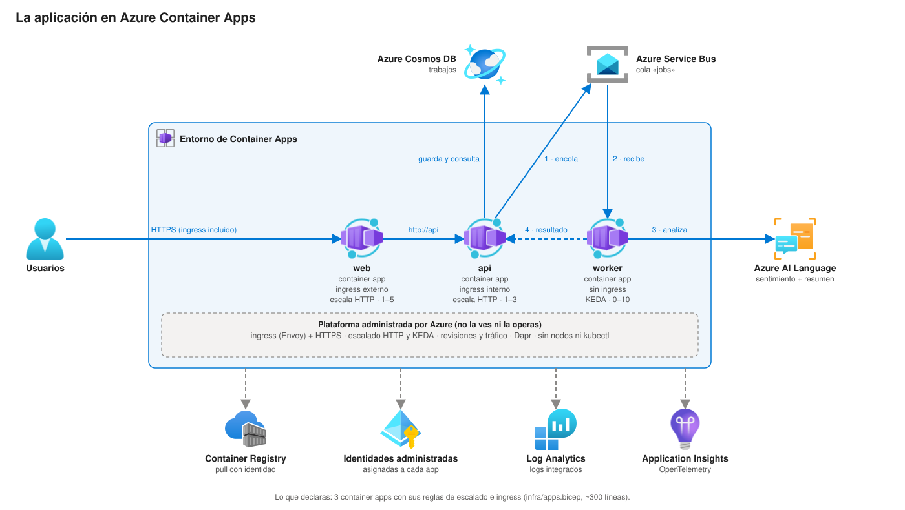

# Conceptos generales de Azure Container Apps

Azure Container Apps es una plataforma **serverless** para ejecutar contenedores. Por debajo usa Kubernetes, KEDA, Envoy y Dapr, pero **no los ves ni los operas**: declaras apps, revisiones y reglas de escalado, y Azure se encarga del resto.

## Ejemplo de arquitectura

La misma aplicación del ejemplo de la clase ([samples/aca-dotnet-bicep](../../samples/aca-dotnet-bicep/)) desplegada en Container Apps:



Compárala con [la misma aplicación en AKS](aks-conceptos.md#ejemplo-de-arquitectura). Diagrama editable: [docs/arquitectura-container-apps.drawio](docs/arquitectura-container-apps.drawio).

## 1. Arquitectura: entorno, apps, revisiones y réplicas

```text
┌──────────────────── Entorno de Container Apps ────────────────────┐
│  red compartida (VNet opcional) · Log Analytics · Dapr            │
│                                                                    │
│  ┌──── Container app "web" ────┐   ┌──── Container app "api" ────┐ │
│  │ revisión web--v1  (80 %)    │   │ revisión api--0000002 (100%)│ │
│  │   réplica · réplica         │   │   réplica                   │ │
│  │ revisión web--v2  (20 %)    │   └─────────────────────────────┘ │
│  │   réplica                   │                                   │
│  └─────────────────────────────┘                                   │
└────────────────────────────────────────────────────────────────────┘
       Sin nodos, sin control plane visible: Azure administra la plataforma
```

- **Entorno:** el límite compartido para un grupo de apps. Comparten red (si usas una VNet propia), destino de logs (Log Analytics) y configuración de Dapr. Las apps del mismo entorno se llaman entre sí por nombre (`http://api`).
- **Container app:** una aplicación, con uno o más contenedores, su ingress, sus secretos y sus reglas de escalado.
- **Revisión:** una **instantánea inmutable** de la configuración de la app (imagen, variables, recursos, escalado). Cada cambio en la plantilla crea una revisión nueva. Los cambios de configuración (ingress, secretos, tráfico) no crean revisión.
- **Réplica:** una instancia en ejecución de una revisión. Es lo que escala.

## 2. Objetos y conceptos principales

| Concepto | Qué es | Equivalente en AKS |
|---|---|---|
| **Entorno** | Límite compartido de red, logs y Dapr | Clúster / namespace |
| **Container app** | La aplicación: contenedores + ingress + escalado | Deployment + Service + Ingress + HPA |
| **Revisión** | Versión inmutable de la plantilla de la app | ReplicaSet |
| **Réplica** | Instancia en ejecución | Pod |
| **Ingress** | HTTP(S) o TCP, externo o interno, con TLS incluido | Ingress controller + certificados |
| **Secretos** | Valores sensibles o referencias a Key Vault, expuestos con `secretRef` | Secrets / Key Vault CSI driver |
| **Reglas de escalado** | HTTP, TCP, CPU, memoria o cualquier scaler de KEDA | HPA + KEDA ScaledObject |
| **Container Apps Jobs** | Tareas que terminan: manuales, programadas (cron) o por eventos | Job / CronJob / KEDA ScaledJob |
| **Init containers y sidecars** | Contenedores auxiliares dentro de la misma réplica | Init containers / sidecars del Pod |
| **Volúmenes** | Almacenamiento efímero o Azure Files | PV / PVC / StorageClass |
| **Sondeos** | Startup, liveness y readiness | Probes del Pod |

## 3. Escalado

En Container Apps escala **un solo nivel: las réplicas**. No hay nodos que agregar, la capacidad la pone Azure.

| Regla | Métrica | Escala a 0 |
|---|---|---|
| **HTTP** | Solicitudes concurrentes por réplica (10 por defecto) | Sí |
| **TCP** | Conexiones concurrentes | Sí |
| **Custom (KEDA)** | Cualquier scaler de KEDA: Service Bus, Storage Queue, Event Hubs, Kafka, Redis, cron... | Sí |
| **CPU / memoria** | Uso de recursos | **No** |

- **`minReplicas` / `maxReplicas`:** con `minReplicas: 0` la app se apaga sin tráfico y no paga cómputo, a cambio de un *cold start* en la primera solicitud.
- **`pollingInterval` (30 s) y `cooldownPeriod` (300 s):** cada cuánto KEDA mira el origen de eventos y cuánto espera antes de bajar al mínimo.
- **Autenticación de los scalers:** con identidad administrada, sin connection strings.

Más detalle en [escalado-automatico.md](escalado-automatico.md).

## 4. Revisiones y tráfico

| Modo | Comportamiento | Uso típico |
|---|---|---|
| **Revisión única** (por defecto) | Solo una revisión activa. La nueva recibe el tráfico cuando está sana; la anterior se desactiva | La mayoría de las apps |
| **Revisiones múltiples** | Varias revisiones activas con **división de tráfico** por porcentaje | *Canary*, blue/green, pruebas A/B |

- **Etiquetas de revisión:** una URL fija por revisión (por ejemplo, `web---v2.<dominio>`) para probarla antes de darle tráfico.
- **Rollback:** volver a darle el tráfico a una revisión anterior, sin recompilar nada.

## 5. Red e ingress

- **Ingress externo o interno:** externo es accesible desde internet; interno, solo dentro del entorno o de la VNet.
- **HTTPS incluido:** certificado administrado para el dominio por defecto (`*.azurecontainerapps.io`) y **certificados administrados gratis** para dominios propios.
- **Descubrimiento de servicios:** `http://<nombre-app>` dentro del mismo entorno.
- **VNet propia:** el entorno se integra en tu VNet, con opción de entorno **solo interno** y *private endpoints*.
- **Otras opciones:** restricciones por IP, CORS, afinidad de sesión (*sticky sessions*), cifrado entre apps del entorno, **autenticación integrada** (Easy Auth con Microsoft Entra ID y otros proveedores).

## 6. Identidad y seguridad

| Identidad | Para qué |
|---|---|
| **Identidad administrada de la app** (sistema o asignada por el usuario) | Que el código acceda a servicios de Azure con `DefaultAzureCredential`, sin claves |
| **Identidad para el registro** | Descargar imágenes de ACR con el rol **AcrPull**, sin contraseñas |
| **Identidad para los scalers** | Que KEDA lea colas o eventos sin connection strings |
| **Usuarios → la plataforma** | **Azure RBAC** sobre el entorno y las apps (no hay `kubectl` ni RBAC de Kubernetes) |

Además:

- **Secretos con referencia a Key Vault:** la app lee el secreto de Key Vault con su identidad.
- **Sin contenedores con privilegios:** la plataforma no los permite.
- **Microsoft Defender for Cloud:** escaneo de vulnerabilidades de las imágenes en ACR.

## 7. Qué administra Azure y qué administras tú

| Lo administra Azure | Lo administras tú |
|---|---|
| Nodos, sistema operativo y parches | La imagen del contenedor y sus dependencias |
| Versión de Kubernetes y sus actualizaciones | Las reglas de escalado y los límites de réplicas |
| Ingress (Envoy), TLS y certificados | La configuración: variables, secretos, ingress |
| KEDA, Dapr y su actualización | Las revisiones y el reparto de tráfico |
| Capacidad y disponibilidad de la plataforma | CPU y memoria por réplica |

## 8. Planes y facturación

Los entornos actuales usan **perfiles de carga de trabajo** (*workload profiles*):

| Perfil | Cómo se cobra | Cuándo usarlo |
|---|---|---|
| **Consumption** | Por uso: vCPU-segundo, GiB-segundo y solicitudes. Sin uso, sin costo. Incluye una cuota mensual gratis por suscripción | La mayoría de las apps, cargas variables, escalado a 0 |
| **Dedicated** | Por instancia de perfil (VMs dedicadas, tamaños D, E y con GPU) | Cargas estables, más CPU o memoria por réplica, aislamiento |

- Un mismo entorno puede combinar perfiles: unas apps en Consumption y otras en Dedicated.
- Hay **GPU serverless** para cargas de IA (inferencia), con disponibilidad por región.
- En Consumption, cada réplica tiene un máximo de CPU y memoria (hasta 4 vCPU y 8 GiB); para más, usa un perfil Dedicated.

## 9. Observabilidad

- **Logs de consola** (lo que escribe la app) y **logs del sistema** (descarga de imágenes, sondeos, escalado) en Log Analytics, o en vivo con `az containerapp logs show --follow`.
- **Métricas** en el portal: solicitudes, réplicas, CPU, memoria, reinicios.
- **Consola del contenedor:** `az containerapp exec` para entrar a una réplica.
- **OpenTelemetry:** la app envía telemetría a Application Insights, directamente o con el agente de OpenTelemetry administrado del entorno.

## 10. Herramientas de despliegue

| Herramienta | Uso |
|---|---|
| `az containerapp up` | Lo más rápido: crea todo desde el código o una imagen |
| `az containerapp create / update` | Control paso a paso desde la CLI |
| **YAML** (`--yaml`) | Configuración completa de la app, revisable en Git |
| **Bicep / ARM / Terraform** | Infraestructura como código (lo que usa el ejemplo de la clase) |
| **Azure Developer CLI** (`azd up`) | Compila, aprovisiona y despliega en un comando |
| **GitHub Actions / Azure DevOps** | CI/CD: compilar la imagen, subirla a ACR y crear una revisión |

## Resumen para la clase

> Container Apps toma los conceptos de Kubernetes (pods, revisiones, KEDA, ingress) y los ofrece como **servicio administrado**: tú declaras **apps, revisiones y reglas de escalado**, y Azure opera los nodos, la red, el TLS, KEDA y Dapr.
>
> Lo que ganas en simplicidad lo pierdes en control: no hay acceso a la API de Kubernetes. Ver [aks-vs-container-apps.md](aks-vs-container-apps.md).
