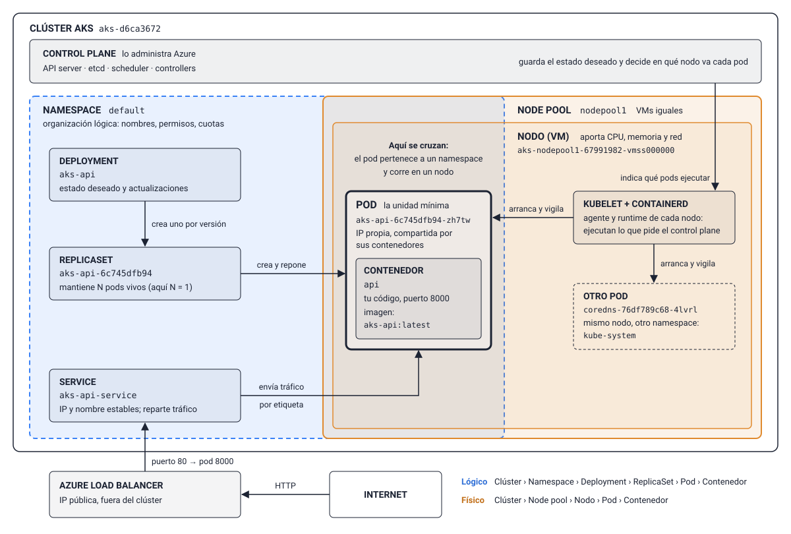

# Anatomía de AKS

Un clúster se organiza de dos maneras al mismo tiempo: por lo que despliegas y por las máquinas donde corre. Las dos llegan al pod.

Recursos reales del clúster de la clase. El namespace (azul) no es una máquina: es una separación lógica que atraviesa los nodos. Por eso, en el mismo nodo (naranja) corren pods de `default` y de `kube-system`. Diagrama editable: [docs/anatomia-aks.drawio](docs/anatomia-aks.drawio).

## Vista lógica: cómo organizas lo que despliegas

| Recurso | Función | Para verlo |
| --- | --- | --- |
| Namespace | Separa recursos por equipo o entorno. Dos recursos pueden llamarse igual en namespaces distintos, y se le pueden aplicar permisos y cuotas. | `kubectl get namespaces` |
| Deployment | Declara qué imagen quieres y cuántas réplicas. Al cambiar la imagen, hace la actualización gradual. | `kubectl get deployments` |
| ReplicaSet | Mantiene la cantidad de pods. Si un pod muere, crea otro. Normalmente no se edita a mano: lo gestiona el Deployment. | `kubectl get replicasets` |
| Service | Da una IP y un nombre estables a un grupo de pods, que se eligen por etiquetas. Hace falta porque los pods cambian de IP al recrearse. El tipo `LoadBalancer` además pide un balanceador a Azure. | `kubectl get services` |

## Vista física: dónde se ejecuta

| Recurso | Función | Para verlo |
| --- | --- | --- |
| Control plane | Recibe las órdenes, guarda el estado deseado y decide en qué nodo va cada pod. Lo administra Azure. | `kubectl cluster-info` |
| Node pool | Agrupa VMs con el mismo tamaño y configuración. Es un concepto de AKS, y se escala desde Azure. | `az aks nodepool list -g <grupo> --cluster-name <clúster>` |
| Nodo | Una VM de tu suscripción que aporta CPU, memoria y red. Es lo que pagas. Su kubelet arranca y vigila los pods que le asignan. | `kubectl get nodes` |

## Donde se cruzan: lo que realmente se ejecuta

| Recurso | Función | Para verlo |
| --- | --- | --- |
| Pod | La unidad mínima que Kubernetes crea y programa. Tiene su propia IP, y es efímero: si se reemplaza, cambian su nombre y su IP. | `kubectl get pods -o wide` |
| Contenedor | Tu aplicación empaquetada en una imagen. Vive siempre dentro de un pod. Kubernetes no lo programa por separado. Los contenedores de un mismo pod comparten red y se ven por `localhost`. | `kubectl logs <pod> -c api` |

Si borras el pod, el ReplicaSet crea otro. Si quieres cambiar algo de forma permanente, edita el Deployment: es la fuente de lo que debe existir.
