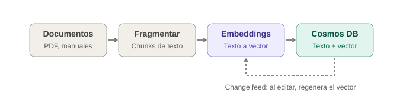
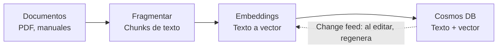
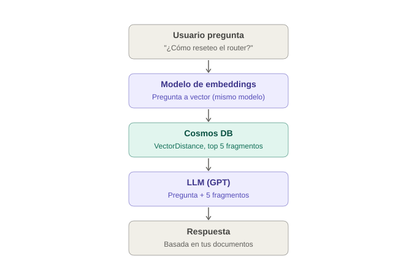
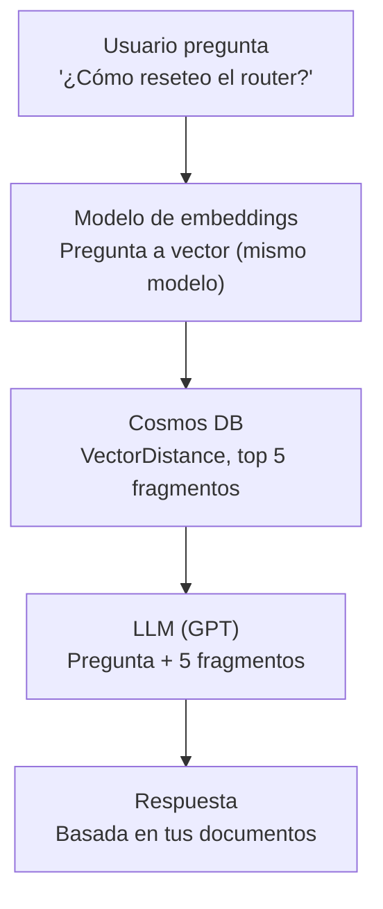

# Arquitectura RAG con vectores en Azure Cosmos DB

RAG (*Retrieval-Augmented Generation*) se entiende mejor en **dos momentos separados**:

1. **La carga de documentos**: pasa una vez, y cada vez que algo cambia.
2. **La consulta**: pasa en cada pregunta del usuario.

> **Frase para la clase:** *"Cosmos DB es la memoria y el LLM es el que habla. La búsqueda vectorial es cómo la memoria encuentra lo relevante para cada pregunta."*

---

## Momento 1: cargar los documentos en Cosmos DB





Este momento pasa **antes de que nadie pregunte nada**.

- **Fragmentar (*chunking*)**: los documentos se cortan en fragmentos de unos pocos párrafos. Un vector representa mejor una idea concreta que un manual entero.
- **Embeddings**: cada fragmento se convierte en vector con el modelo de embeddings.
- **Cosmos DB**: guarda el vector **junto con su texto** en el mismo documento JSON.
- **Change feed** (flecha punteada): si alguien edita un documento, una Azure Function regenera el vector automáticamente.

Así queda cada fragmento guardado en Cosmos DB:

```json
{
  "id": "manual-router-chunk-07",
  "sourceDocument": "Manual del router X200.pdf",
  "category": "networking",
  "content": "Para resetear el router, mantené presionado el botón trasero durante 10 segundos...",
  "contentHash": "a3f9c2...",
  "embedding": [0.023, -0.041, 0.118, ...]
}
```

---

## Momento 2: responder una pregunta





Este momento se repite **en cada pregunta**, y es donde trabajan los vectores de Cosmos DB:

1. **Usuario pregunta**: escribe en lenguaje natural.
2. **Modelo de embeddings**: convierte la pregunta en vector. Tiene que ser **el mismo modelo** que se usó en la carga: mismo mapa para documentos y preguntas.
3. **Cosmos DB**: encuentra los 5 fragmentos más cercanos en el mapa de significados. **No responde la pregunta**, solo busca.
4. **LLM**: recibe la pregunta más esos 5 fragmentos y escribe la respuesta.
5. **Respuesta**: se basa en tus documentos, no en lo que el modelo "recuerda" de internet.

### La consulta en Cosmos DB (paso 3)

```sql
SELECT TOP 5 c.content, c.sourceDocument,
       VectorDistance(c.embedding, @queryVector) AS Score
FROM c
ORDER BY VectorDistance(c.embedding, @queryVector)
```

### El prompt que recibe el LLM (paso 4)

```text
Respondé la pregunta usando solo la información del contexto.
Si la respuesta no está en el contexto, decí que no la sabés.

Contexto:
[Fragmento 1] Para resetear el router, mantené presionado el botón trasero...
[Fragmento 2] Si el router no responde después del reset...
[Fragmento 3] ...

Pregunta: ¿Cómo reseteo el router?
```

La instrucción *"si no está en el contexto, decí que no la sabés"* es la que reduce que el modelo invente respuestas.

---

## Los dos modelos, para no confundirlos

| | Modelo de embeddings | LLM |
|---|---|---|
| Ejemplo | `text-embedding-3-small` | GPT-4o |
| Qué hace | Convierte texto en vector | Escribe texto |
| Dónde aparece | En los dos momentos (carga y consulta) | Solo en la consulta |
| Qué devuelve | Una lista de números | La respuesta para el usuario |

---

## Preguntas frecuentes

- **¿Por qué no le paso todos los documentos directamente al LLM?**
  Porque el LLM tiene un límite de texto que puede recibir, cobra por cada token y responde peor cuando el contexto tiene mucha información irrelevante. Cosmos DB filtra y le pasa solo lo relevante.
- **¿Por qué fragmentar los documentos?**
  Un vector de un manual de 50 páginas mezcla todos sus temas y queda "en el medio" del mapa. Un vector de un párrafo representa una idea concreta y se encuentra con precisión.
- **¿Cuántos fragmentos le paso al LLM?**
  Entre 3 y 10 es lo habitual. Pocos pueden dejar afuera información; muchos agregan ruido y costo.
- **¿Qué pasa si actualizo un documento?**
  El change feed detecta el cambio y regenera el vector, como vimos en la slide correspondiente.
- **¿Puedo combinar con filtros?**
  Sí: agregás un `WHERE` (por ejemplo, `c.category = 'networking'`) para buscar solo dentro de un "barrio", o usás búsqueda híbrida con RRF para códigos de error y nombres de producto.
