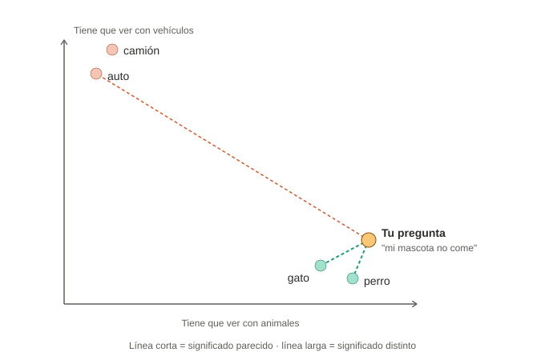

# Vectores, distancias e índices en Azure Cosmos DB

Guía de apoyo para explicar la búsqueda vectorial desde cero, sin fórmulas.

---

## 1. ¿Qué es un vector?

Un vector es una **lista de números que ubica algo en un mapa de significados**.

Imaginá que querés ubicar palabras en un mapa usando solo dos preguntas:

- ¿Cuánto tiene que ver con **animales**? (de 0 a 10)
- ¿Cuánto tiene que ver con **vehículos**? (de 0 a 10)

| Palabra | Animales | Vehículos | Vector |
|---|---|---|---|
| perro | 9 | 1 | (9, 1) |
| gato | 8 | 1.5 | (8, 1.5) |
| auto | 1 | 9 | (1, 9) |
| camión | 1.5 | 10 | (1.5, 10) |

Esos pares de números son **vectores**. Nada más que eso.



<details>
<summary>Versión en texto del gráfico</summary>

```
 Vehículos
    ^
 10 |   camión
  9 |  auto
    |      \
    |        \  (línea larga = distinto)
    |          \
    |            \
  2 |              \___  ★ Tu pregunta: "mi mascota no come"
  1 |                   gato  perro   (líneas cortas = parecido)
    +-------------------------------------> Animales
    0                                   10
```

</details>

---

## 2. Buscar = encontrar a los vecinos más cercanos

Cuando alguien pregunta **"mi mascota no come"**, el modelo de embeddings también ubica esa frase en el mapa. Cae cerca de "perro" y "gato", así que la base de datos devuelve esos documentos, **aunque la pregunta no use ninguna de esas palabras**.

> Esa es la magia de la búsqueda vectorial: **busca por significado, no por palabras exactas.**

---

## 3. La "distancia" es cómo medís "cerca"

| Función | Analogía | Qué mira |
|---|---|---|
| **Euclidiana** | Una **regla** | La línea recta entre dos puntos. Número más bajo = más cerca. |
| **Coseno** | Una **brújula** | Solo **hacia dónde apunta** cada vector visto desde el origen, no qué tan lejos está. Número más alto = más parecido. |
| **Producto escalar** | Brújula + potencia | La dirección y además el largo del vector. Número más alto = más parecido. |

Con los modelos de OpenAI (ada-002, text-embedding-3), **coseno y producto escalar dan exactamente el mismo resultado**, porque todos los vectores vienen con el mismo largo (normalizados). En la práctica se pueden tratar como equivalentes. El producto escalar es apenas más barato de calcular.

### ¿Y las 1536 dimensiones?

Es la misma idea, pero en lugar de 2 preguntas ("¿animales?", "¿vehículos?") el modelo usa **1536**. Nadie sabe qué representa cada una y no se pueden dibujar, pero el principio no cambia: **cada texto es un punto, y lo parecido queda cerca.**

### Frase resumen para la clase

> *"Un embedding es la dirección de un texto en un mapa de significados. Buscar es encontrar a los vecinos más cercanos, y la función de distancia es la regla con la que medimos quién está cerca."*

---

## 4. Tipos de índice: cómo encontrar a los vecinos rápido

Ya sabemos **qué** buscamos (los vecinos más cercanos). El índice decide **cómo** los buscamos. Los tres tipos son estrategias distintas para el mismo problema.

### Analogía: encontrar a las personas que viven más cerca de tu casa

**flat: tocar timbre por timbre**
Recorrés **todas** las casas de la ciudad, medís la distancia exacta a cada una y te quedás con las más cercanas.

- Resultado **100 % exacto**.
- Lento y caro cuando hay muchas casas.
- En Cosmos DB tiene un **límite de 505 dimensiones**: con ada-002 (1536) **no se puede usar**.

**quantizedFlat: recorrer todas las casas con un mapa simplificado**
Seguís revisando todas las casas, pero con un mapa resumido (comprimido) que es más liviano de leer.

- Mucho más rápido y barato que flat.
- Precisión casi exacta: la compresión pierde un poco de detalle.
- Recomendado hasta **~50 000 vectores por partición física**.
- Hasta **4096 dimensiones**.

**diskANN: preguntarle a los vecinos**
No revisás todas las casas. Empezás en un punto y preguntás: *"¿quién vive más cerca de esta dirección?"*. Saltás a esa casa, volvés a preguntar, y en pocos saltos llegás al barrio correcto. Técnicamente es un **grafo** que conecta cada vector con sus vecinos (tecnología de Microsoft Research).

- El más rápido y barato a **gran escala** (millones de vectores).
- Resultado **aproximado**, aunque con precisión muy alta.
- Hasta **4096 dimensiones**.

### Tabla comparativa

| | flat | quantizedFlat | diskANN |
|---|---|---|---|
| Cómo busca | Revisa todo, exacto | Revisa todo, comprimido | Salta entre vecinos (grafo) |
| Precisión | 100 % | Casi exacta | Aproximada, muy alta |
| Máx. dimensiones | 505 | 4096 | 4096 |
| Escala ideal | Pocos vectores | Hasta ~50 000 por partición física | Grandes volúmenes |
| Costo en RU a escala | Alto | Medio | Bajo |

### ¿Cuál elijo?

1. **¿Tu modelo tiene más de 505 dimensiones?** (ada-002 = 1536) → descartá **flat**.
2. **¿Pocos vectores por partición (≲ 50 000)?** → **quantizedFlat**.
3. **¿Muchos vectores o esperás crecer?** → **diskANN**.

> **Punto clave para la clase:** con ada-002 la decisión real es entre **quantizedFlat** y **diskANN**, según el volumen de datos.

---

## 5. Preguntas frecuentes de alumnos

- **"¿Por qué no uso siempre flat si es exacto?"**
  Por el límite de dimensiones y porque revisar todo escala mal en latencia y RU.
- **"¿Aproximado significa que me da resultados malos?"**
  No. diskANN encuentra casi siempre los mismos vecinos que una búsqueda exacta, pero mucho más rápido.
- **"¿'Partición' es la clave de partición?"**
  No. El límite de ~50 000 se refiere a la **partición física**, no a la lógica.
- **"¿Coseno o producto escalar?"**
  Con embeddings de OpenAI dan el mismo ranking. Coseno es el default más seguro.

---

> **Nota:** los límites (505, ~50 000, 4096) y las capacidades de Cosmos DB cambian con frecuencia. Verificalos contra la documentación actual de Microsoft Learn antes de dictar el curso.
