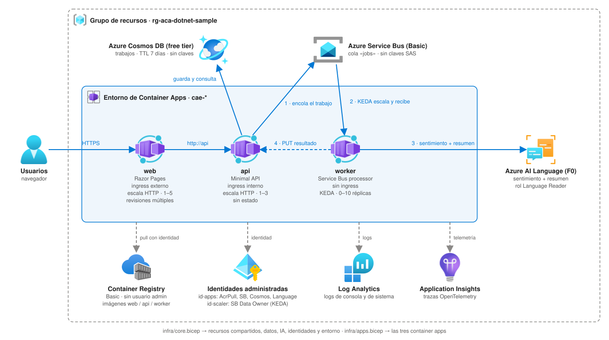

# Azure Container Apps de punta a punta: .NET 10 + Bicep

Ejemplo completo y funcional para la clase de Azure Container Apps. Tres apps .NET 10 en un mismo entorno:

- La **web** recibe opiniones de clientes.
- La **API** las guarda en **Cosmos DB** y las encola en **Service Bus**.
- Un **worker** las analiza con **Azure AI Language** (sentimiento y resumen) y escala con KEDA según la cola.

Toda la infraestructura está en Bicep, y el despliegue es un script de PowerShell con los pasos a la vista. Ninguna app usa contraseñas ni claves: todo funciona con identidades administradas.



El diagrama editable está en [docs/architecture.drawio](docs/architecture.drawio). Ábrelo con la extensión *Draw.io Integration* de VS Code o en [app.diagrams.net](https://app.diagrams.net).

## Qué conceptos muestra y dónde verlos

| Concepto | Dónde está |
|---|---|
| Entorno compartido (red y logs) | `environment` en [infra/core.bicep](infra/core.bicep) |
| Extraer imágenes de ACR sin contraseñas (identidad + `AcrPull`) | `registries` en [infra/apps.bicep](infra/apps.bicep) y `acrPullAssignment` en core.bicep |
| Ingress externo, interno y sin ingress | `web`, `api` y `worker` en apps.bicep |
| Descubrimiento de servicios por nombre (`http://api`) | `API_BASE_URL` en apps.bicep |
| Variables de entorno y secretos (`secretRef`) | `commonEnv` y `secrets` en apps.bicep |
| Identidad administrada en el código (sin claves) | `DefaultAzureCredential` en [src/Api/Program.cs](src/Api/Program.cs) y [src/Worker/Program.cs](src/Worker/Program.cs) |
| Sondeos de liveness y readiness | `probes` en apps.bicep, `/health/*` en cada `Program.cs` |
| Escalado HTTP | regla `http-concurrency` de la web y de la API |
| Escalado por eventos con KEDA (0..N) | regla `servicebus-queue` del worker |
| `pollingInterval` y `cooldownPeriod` | `scale` del worker |
| Mínimo privilegio (identidad distinta para KEDA) | `scalerIdentity` en core.bicep |
| Revisiones múltiples y división de tráfico | `activeRevisionsMode: 'Multiple'` y [scripts/traffic-split.ps1](scripts/traffic-split.ps1) |
| Contenedores sin estado (el estado vive en Cosmos DB) | [src/Api/JobStore.cs](src/Api/JobStore.cs) y `cosmos` en core.bicep |
| IA con Azure AI Language (sentimiento y resumen) | [src/Worker/TextAnalyzers.cs](src/Worker/TextAnalyzers.cs) y `language` en core.bicep |
| Telemetría distribuida con OpenTelemetry | `UseAzureMonitor()` en cada `Program.cs` |

## Estructura

```text
aca-dotnet-bicep/
├── docs/
│   ├── architecture.svg    # Diagrama de arquitectura (se ve en este README)
│   └── architecture.drawio # El mismo diagrama, editable en draw.io
├── infra/
│   ├── core.bicep          # Log Analytics, App Insights, ACR, Service Bus, Cosmos DB,
│   │                       # Azure AI Language, identidades, RBAC y entorno
│   └── apps.bicep          # Las tres container apps (web, api, worker)
├── scripts/
│   ├── deploy.ps1          # Despliegue completo en 4 pasos
│   ├── watch.ps1           # Réplicas, revisiones, tráfico y cola en vivo
│   ├── load-test.ps1       # Carga HTTP contra la web
│   ├── traffic-split.ps1   # Revisión nueva con una parte del tráfico
│   └── cleanup.ps1         # Elimina el grupo de recursos
└── src/
    ├── Web/                # Razor Pages + proxy hacia la API
    ├── Api/                # Minimal API: guarda los trabajos en Cosmos DB y los encola
    └── Worker/             # Procesa la cola con Azure AI Language y devuelve el resultado a la API
```

## Requisitos

- Suscripción de Azure con rol **Owner**, o **Contributor** + **User Access Administrator**, sobre el grupo de recursos: la plantilla crea asignaciones de roles.
- [Azure CLI](https://learn.microsoft.com/cli/azure/install-azure-cli) 2.60 o superior, con sesión iniciada (`az login`).
- [PowerShell 7](https://learn.microsoft.com/powershell/scripting/install/installing-powershell) (`pwsh`).
- **No hace falta Docker**: ACR compila las imágenes en la nube (`az acr build`).
- [.NET 10 SDK](https://dotnet.microsoft.com/download), solo si quieres compilar o ejecutar en local.

## Despliegue

```powershell
cd samples/aca-dotnet-bicep
./scripts/deploy.ps1
```

Tarda entre 10 y 15 minutos la primera vez. El script:

1. Crea el grupo de recursos `rg-aca-dotnet-sample` en `centralus`.
2. Despliega `infra/core.bicep`.
3. Compila las tres imágenes en ACR con una etiqueta de fecha y hora.
4. Despliega `infra/apps.bicep` y muestra la URL de la web.

Opciones útiles:

```powershell
./scripts/deploy.ps1 -ResourceGroup rg-alumno01 -Location eastus2
./scripts/deploy.ps1 -SkipInfra     # cambiaste código: solo recompila imágenes y actualiza las apps
```

> **¿Por qué dos plantillas?** Una container app necesita que su imagen ya exista en el registro. `core.bicep` crea el ACR, el script compila las imágenes y recién entonces `apps.bicep` crea las apps.

### Costo y tiers gratis

| Recurso | Tier | Costo |
|---|---|---|
| Cosmos DB | **Free tier**: 1000 RU/s + 25 GB gratis | Gratis. Solo se permite **una cuenta free tier por suscripción**. |
| Azure AI Language | **F0**: 5.000 registros de texto al mes | Gratis. Al llegar al límite el servicio frena las llamadas, no cobra. Se permite **uno por suscripción**. |
| Container Apps | Consumption | Por uso; en una clase son centavos. El worker en 0 réplicas no consume. |
| Service Bus, Log Analytics | Basic, por GB | Por uso; centavos. |
| Container Registry | Basic | Costo diario fijo. |

Si la suscripción ya usa el free tier de Cosmos DB o ya tiene un Language F0 en otro grupo de recursos, `deploy.ps1` lo detecta y crea Cosmos DB en modo **serverless** y Language con SKU **S** (los dos de pago por uso). Si varios alumnos comparten una suscripción, solo el primero obtiene los recursos gratis.

Ejecuta `./scripts/cleanup.ps1` al terminar.

## Recorrido sugerido para la clase

Abre dos terminales. En una deja corriendo el monitor:

```powershell
./scripts/watch.ps1
```

### 1. Usar la app

Abre la URL de la web y escribe una opinión de dos o tres oraciones. Sigue su recorrido:

1. La API la guarda en Cosmos DB como **Pendiente** y la pone en la cola.
2. El worker la toma y llama a Azure AI Language.
3. Pasa a **Completado**, con el **sentimiento** (positivo, negativo, neutral o mixto), un **resumen** en una oración, el motor usado y la réplica que la procesó.

La primera vez puede tardar más: el worker empieza en **0 réplicas** y KEDA tiene que arrancar una (*cold start*). El resumen abstractivo es una operación asíncrona de Language, así que cada trabajo tarda algunos segundos.

### 2. Escalado por eventos (KEDA)

En la web, genera **50 trabajos**. En `watch.ps1` vas a ver:

- Los mensajes pendientes en la cola suben a ~50.
- En el siguiente sondeo (`pollingInterval: 15`), el worker escala a 10 réplicas: objetivo de 5 mensajes por réplica, con un máximo de 10.
- La tarjeta "réplicas de worker usadas" de la web sube.
- Al vaciarse la cola, y pasado el `cooldownPeriod` de 60 s, el worker vuelve a **0**.

> **Cuota gratis:** cada trabajo usa unos 2 registros de Language (sentimiento + resumen). 50 trabajos ≈ 100 registros de los 5.000 del mes. La web permite como máximo 200 trabajos por vez.

Para discutir:

- ¿Qué pasaría con `MAX_CONCURRENT_CALLS=5`? ¿Y con `messageCount: '20'`?
- Con 10 réplicas en paralelo, el tier F0 puede responder **429 (demasiadas solicitudes)**. El SDK reintenta con espera exponencial y, si sigue fallando, el mensaje vuelve a la cola. `maxReplicas` no solo controla el costo: también protege a los servicios de los que depende la app.

### 3. Escalado HTTP

```powershell
./scripts/load-test.ps1 -Concurrency 30 -DurationSeconds 120 -DelayMs 500
```

Con la regla de 10 solicitudes simultáneas por réplica, la web debería llegar a unas **3 réplicas**. Al final, el script muestra cuántas réplicas distintas respondieron.

| Parámetro | Significado |
|---|---|
| `-Concurrency` | Usuarios virtuales en paralelo (≈ solicitudes simultáneas) |
| `-DurationSeconds` | Duración de la prueba |
| `-DelayMs` | Lo que tarda `/simulate` en responder. Más alto = más solicitudes abiertas a la vez |

### 4. Revisiones múltiples y división de tráfico

```powershell
./scripts/traffic-split.ps1 -NewVersion v2 -NewWeight 20
```

Crea la revisión `v2` de la web (banda **verde** en lugar de azul) y le da el 20 % del tráfico. Recarga la página varias veces, o vuelve a ejecutar `load-test.ps1`: el resumen "Respuestas por revisión" debería mostrar ~80/20. Al terminar, el script imprime los comandos para promover, volver atrás y desactivar.

> Si vuelves a ejecutar `deploy.ps1`, la plantilla devuelve el 100 % del tráfico a la última revisión (`latestRevision: true`). En modo múltiple, las revisiones anteriores **siguen activas** con 0 % de tráfico y cada una mantiene su réplica mínima encendida, que también se cobra. Desactívalas con `az containerapp revision deactivate`.

### 5. Diagnóstico: una revisión que no arranca

La API exige la variable `SERVICEBUS_FQDN`. Si se la quitas, se crea una revisión nueva que falla al iniciar:

```powershell
$rg = "rg-aca-dotnet-sample"
az containerapp update -n api -g $rg --remove-env-vars SERVICEBUS_FQDN
az containerapp revision list -n api -g $rg -o table
az containerapp logs show -n api -g $rg --type console --tail 30
```

En los logs aparece `Falta la variable de entorno obligatoria 'SERVICEBUS_FQDN'`. La API está en modo de revisión única, así que la revisión anterior sigue atendiendo hasta que la nueva esté lista: la web sigue funcionando.

Para corregirlo:

```powershell
$sb = az deployment group show -g $rg -n core --query properties.outputs.serviceBusName.value -o tsv
az containerapp update -n api -g $rg --set-env-vars "SERVICEBUS_FQDN=$sb.servicebus.windows.net"
```

### 6. Contenedores sin estado

```powershell
az containerapp revision restart -n api -g $rg --revision (az containerapp revision list -n api -g $rg --query "[0].name" -o tsv)
```

Reinicia la API: la tabla de la web **sigue mostrando todos los trabajos**, porque viven en Cosmos DB y no en la memoria del contenedor. Por eso la API puede escalar de 1 a 3 réplicas por HTTP: cualquier réplica lee los mismos datos. La tarjeta "Réplica api" de la web muestra qué réplica respondió.

Para discutir: ¿qué pasaría si cada réplica guardara su propia lista en memoria? (Era la primera versión de este ejemplo.)

Los documentos tienen un TTL de 7 días (`defaultTtl` en core.bicep): Cosmos DB los borra solo y la demo no acumula datos.

### 7. Cambiar el motor de IA sin tocar código

El worker usa Azure AI Language si existe la variable `LANGUAGE_ENDPOINT`. Si la quitas, vuelve al análisis **simulado** (palabras clave, sin costo ni cuota):

```powershell
az containerapp update -n worker -g $rg --remove-env-vars LANGUAGE_ENDPOINT
```

La columna "Motor" de la web pasa de `Azure AI Language` a `simulado`. Para volver:

```powershell
$lang = az deployment group show -g $rg -n core --query properties.outputs.languageAccountName.value -o tsv
az containerapp update -n worker -g $rg --set-env-vars "LANGUAGE_ENDPOINT=https://$lang.cognitiveservices.azure.com/"
```

Es un buen ejemplo de configuración por variables de entorno: la misma imagen se comporta distinto en cada revisión.

### 8. Observabilidad

- **Logs de consola en vivo:** `az containerapp logs show -n worker -g $rg --follow`
- **Logs del sistema** (extracción de imágenes, sondeos, escalado): `az containerapp logs show -n worker -g $rg --type system`
- **Log Analytics** (el ID está en las salidas de `core`):

  ```powershell
  $ws = az deployment group show -g $rg -n core --query properties.outputs.logAnalyticsWorkspaceId.value -o tsv
  az monitor log-analytics query -w $ws -o table --analytics-query "ContainerAppConsoleLogs_CL | where ContainerAppName_s == 'worker' | project TimeGenerated, Log_s | order by TimeGenerated desc | take 20"
  ```

- **Application Insights:** en el portal, abre el recurso `appi-*` y revisa **Application map** (los tres servicios y sus dependencias: Cosmos DB, Service Bus, Language) y **Transaction search** (el recorrido de una solicitud). La telemetría puede tardar entre 2 y 5 minutos en aparecer.

## Ejecutar en local (opcional)

La API y el worker usan los servicios reales de Azure, y todos tienen las claves desactivadas. Tu usuario necesita roles de datos sobre Service Bus, Cosmos DB y Language:

```powershell
$rg = "rg-aca-dotnet-sample"
$me = az ad signed-in-user show --query id -o tsv
$out = az deployment group show -g $rg -n core --query properties.outputs -o json | ConvertFrom-Json

$sbId = az servicebus namespace show -g $rg -n $out.serviceBusName.value --query id -o tsv
az role assignment create --assignee $me --role "Azure Service Bus Data Owner" --scope $sbId

$langId = az cognitiveservices account show -g $rg -n $out.languageAccountName.value --query id -o tsv
az role assignment create --assignee $me --role "Cognitive Services Language Reader" --scope $langId

az cosmosdb sql role assignment create -g $rg -a $out.cosmosAccountName.value `
    --role-definition-id 00000000-0000-0000-0000-000000000002 --principal-id $me --scope "/"
```

Después, en tres terminales (`DefaultAzureCredential` usa tu sesión de `az login`):

```powershell
$env:SERVICEBUS_FQDN = "$($out.serviceBusName.value).servicebus.windows.net"
$env:COSMOS_ENDPOINT = "https://$($out.cosmosAccountName.value).documents.azure.com:443/"
$env:LANGUAGE_ENDPOINT = "https://$($out.languageAccountName.value).cognitiveservices.azure.com/"

dotnet run --project src/Api       # http://localhost:5001
dotnet run --project src/Worker    # http://localhost:5002
dotnet run --project src/Web       # http://localhost:5000
```

Si la versión desplegada también está consumiendo la cola, los mensajes se reparten entre los workers locales y los de Azure.

## Limpieza

```powershell
./scripts/cleanup.ps1
```

## Problemas comunes

| Síntoma | Causa probable |
|---|---|
| `deploy.ps1` falla al crear las asignaciones de roles | Tu usuario no tiene permiso para asignar roles (hace falta Owner o User Access Administrator). |
| Falla la creación de Cosmos DB con un error de capacidad en la región | Algunas regiones limitan las cuentas nuevas. Despliega con `-Location` en otra región (por ejemplo, `eastus2`). |
| El worker no escala o los logs muestran `Unauthorized` / `403` | Las asignaciones de RBAC recién creadas pueden tardar unos minutos en propagarse. Espera y genera trabajos de nuevo. |
| Los logs del worker muestran `429` | Se alcanzó el límite de llamadas del tier F0 de Language. Los mensajes se reintentan solos; baja `maxReplicas` o genera menos trabajos. |
| Los trabajos quedan en "Pendiente" para siempre | KEDA no puede leer la cola, o Language rechaza las llamadas (cuota mensual agotada). Revisa los logs del worker. |
| La web muestra "No se pudo contactar la API" | Revisa que la revisión de la API esté sana: `az containerapp revision list -n api -g $rg -o table`. |
